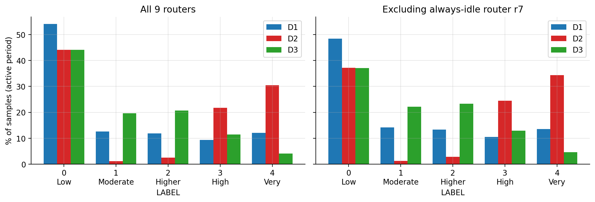
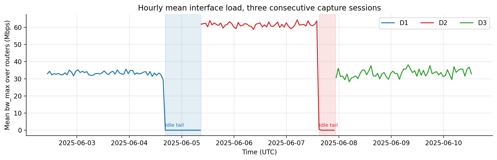
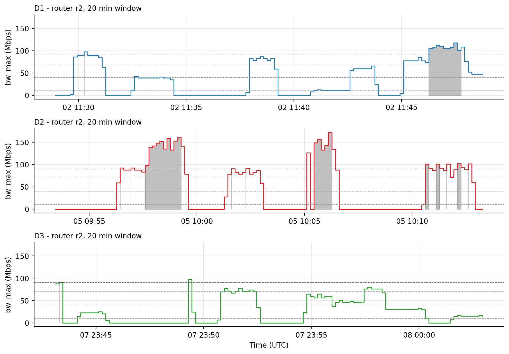
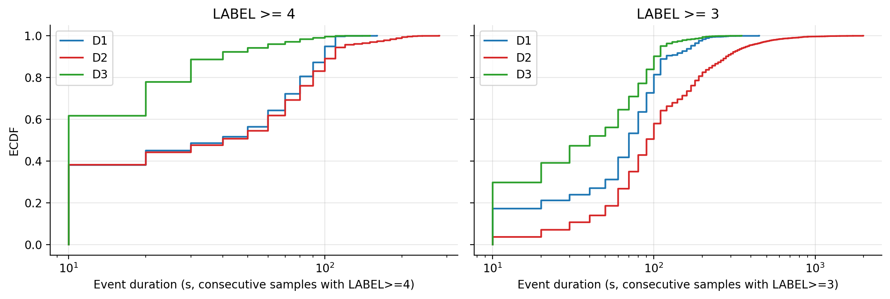
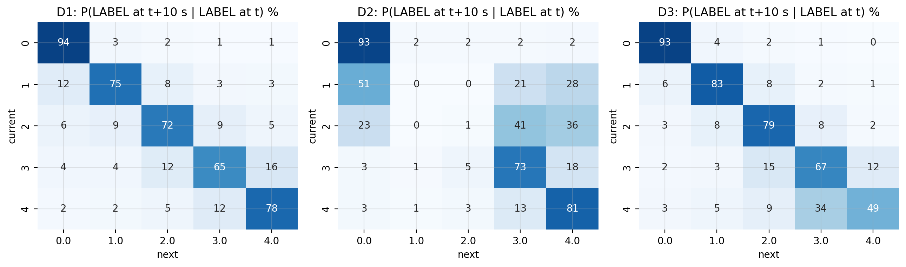
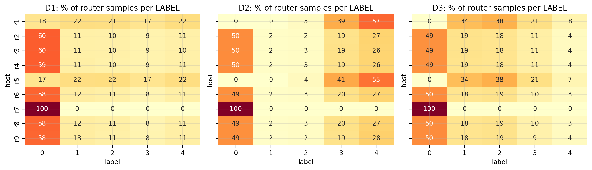
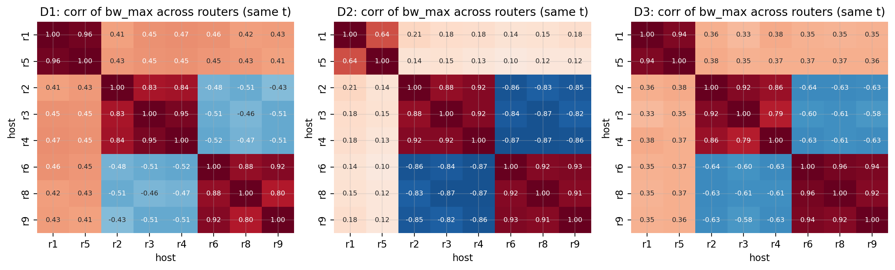
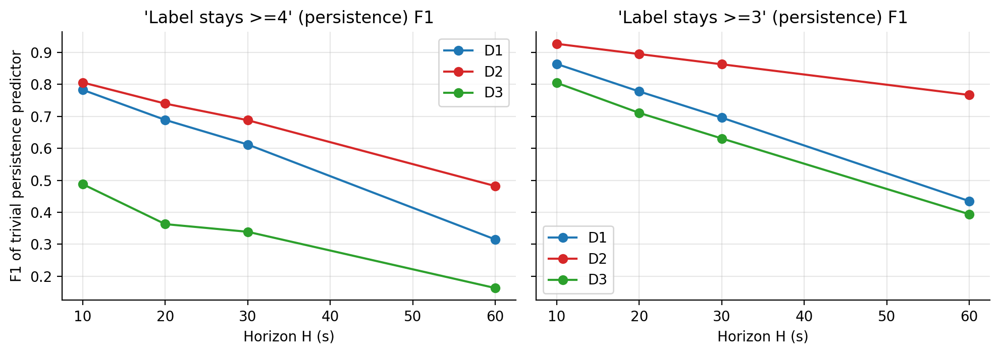
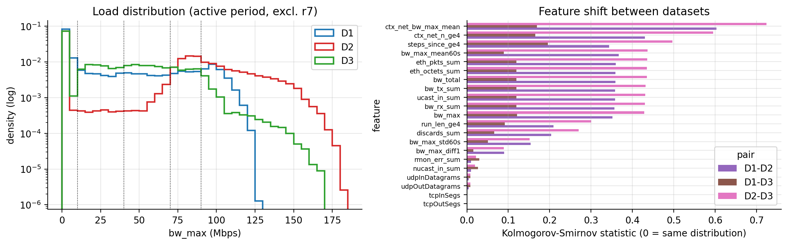
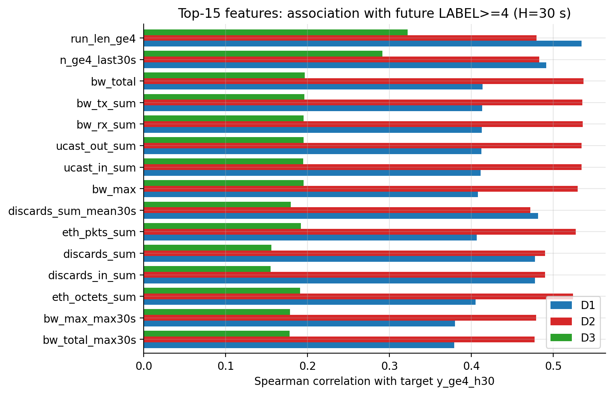

# EDA & Preprocessing Report - Robust Early Warning under High-Load Network Conditions

Datasets: `dataset_01_TC31_05062025`, `dataset_02_TC31_07062025`, `dataset_03_TC31_10062025` (labeled CSVs).
All numbers below are produced by the code in [`src/`](../src) (tables in [`reports/tables/`](tables), figures in [`reports/figures/`](figures)).

---

## 1. What the data is

| | D1 | D2 | D3 |
|---|---|---|---|
| Rows (9 routers x 10 s samples) | 227,838 | 199,547 | 202,445 |
| Raw columns | 104 | 104 | 104 |
| Period (UTC, June 2025) | 2 Jun 10:28 - 5 Jun 08:48 | 5 Jun 08:53 - 7 Jun 22:28 | 7 Jun 22:43 - 10 Jun 13:12 |
| Duration | 70.3 h | 61.6 h | 62.5 h |
| **Idle tail** (no traffic at all) | **16.5 h (23.4 %)** | **7.6 h (12.3 %)** | none |
| Peak interface load | 125 Mbps | 181 Mbps | 168 Mbps |

* One row = one router (`r1`..`r9`) at one 10 s polling instant. The three files are consecutive capture sessions.
* Timestamps are Unix seconds; every router is sampled **exactly every 10 s** in all three files (no gaps, no duplicates).
* `ifInOctets`/`ifOutOctets`/`etherStats*` are **per-interval deltas** (not cumulative counters), so no differencing is needed. `bw_rx_i = floor(ifInOctets_i x 8 / 10 s / 1e6, 0.1 Mbps)` holds exactly.
* **`LABEL` is a deterministic binning of the maximum interface bandwidth of that router at that instant**
  (`max(bw_rx_i, bw_tx_i)`: <10 -> 0, 10-40 -> 1, 40-70 -> 2, 70-90 -> 3, >=90 -> 4). I verified 100 % agreement on all three files (0 mismatches). Labels are **per router**, not network-wide.

## 2. Data-quality findings and what I did about them

| Finding | Evidence | Treatment |
|---|---|---|
| Timestamp anomaly mentioned in the proposal for D1 | **Not present in the files you uploaded**: all timestamps numeric, in range, on the 10 s grid, no duplicates | Validation code stays in the pipeline (drops invalid, snaps off-grid, de-duplicates, re-grids) and logs counts - all zero here |
| Idle tails in D1 (16.5 h) and D2 (7.6 h) | Traffic generator stopped; max load in tail <= 3.3 Mbps, LABEL always 0 | Flagged `idle_tail=1` in the clean data; **removed from model-ready tables** (configurable). Without this, a naive chronological 70/15/15 split gives D1 a test set with **0 positives** and D2 a test set that is mostly idle |
| 15 columns constant in all three files (e.g. `Interfaces`, `tcpRetransSegs`, `tcpCurrEstab`, `udpInErrors`, `bw_tx_6`, several `*_NUcastPkts`) | `nunique <= 1` | Dropped (list in `reports/tables/cleaning_log.json`) |
| Interface 6 exists on only 2 of 9 routers (r6, r8) | 7 routers have 100 % NaN on all `*_6` columns | Structural zeros + `has_if6` flag |
| Sporadic SNMP polling gaps | D1 3,852 / D2 6,933 / D3 4,772 rows with >=1 missing value (1.7-3.5 %); in D1 every gap is a single sample | (1) rebuild `bw` from octet counters where only the `bw` was missing (2,844 / 5,280 / 3,283 values), (2) causal forward-fill <= 20 s, (3) `any_imputed`, `n_imputed` flags. 1 unfillable row dropped in D2. LABEL consistency unaffected (0 mismatches) |
| Router r7 never carries load | 100 % LABEL 0, bw = 0 (~11 % of rows) | Kept (flag `host_group="idle"`); excluded by default in `src/modeling_utils.py` and in all metrics below, because it only adds trivially easy negatives |
| Column names do not always match behavior | `hostOutPkts` ~ `etherStatsOctets` (bytes, not packets); `etherStatsJabbers` ~ `etherStatsPkts - 1` (packet-like, not an error counter); `ifInUcastPkts` correlates 1.0 with `ifInOctets`; `tcpInSegs`/`tcpOutSegs` only take values 0-4 | Aggregated features avoid `Jabbers` in the error sum; do not describe these columns by their SNMP names in the paper without checking the generator. 46 feature pairs have \|r\| > 0.98 (`reports/tables/redundant_feature_pairs_gt098.csv`) |
| Loads above 100 Mbps (up to 181 Mbps) | Consistent with the octet counters | **Kept** (real measurements; LABEL 4 is open-ended). Link capacity is not documented - state this assumption in the paper |

No scaling, clipping, or resampling is baked into the files (scalers must be fit on training rows only; see `src/modeling_utils.py::scale_fit_on_train`).

## 3. EDA insights

**Insight 1 - The three datasets differ in three different ways** (Fig 1, 2, 9)

| LABEL (excl. r7, active period) | D1 | D2 | D3 |
|---|---|---|---|
| 0 / 1 / 2 / 3 / 4 (%) | 48 / 14 / 13 / 10.5 / 13.6 | 37 / 1 / 3 / 24.5 / 34.3 | 37 / 22 / 23 / 13 / 4.6 |
| LABEL >= 4 prevalence | 13.6 % | 34.3 % | 4.6 % |
| LABEL >= 3 prevalence | 24.1 % | 58.8 % | 17.5 % |

* **D2 = level shift**: hourly mean load ~61 Mbps vs ~33 Mbps in D1 and D3; the "moderate" classes 1-2 almost vanish. KS distance between D2 and the others reaches 0.6-0.7 on load features.
* **D3 = burst/dynamics shift**: its load *level* distribution is close to D1 (KS 0.09-0.2) but high-load events are far shorter (next point).
* With LABEL >= 3 as the positive class, D2 is >50 % positive, so accuracy is meaningless there. Use precision/recall/F1/PR-AUC and report prevalence per dataset.

**Insight 2 - D3 high-load events are short bursts** (Fig 3, 4)

| LABEL >= 4 events (per router) | D1 | D2 | D3 |
|---|---|---|---|
| Number of events | 4,565 | 10,364 | 4,253 |
| Median duration | 40 s | 40 s | **10 s** |
| Single-sample events (10 s) | 38 % | 38 % | **62 %** |
| Shorter than or equal to 30 s | 49 % | 48 % | **89 %** |
| Longest | 160 s | 280 s | 150 s |

This confirms the proposal's burst hypothesis for D3. Consequence: at horizons of 30-60 s, most D3 high-load events start *and end* inside the horizon window.

**Insight 3 - "Persistence" is a strong baseline that collapses on D3** (Fig 8)

Because LABEL(t) is fully determined by the current bandwidth columns, "future state = current state" is information every model already has. F1 of that trivial predictor for LABEL >= 4:

| Horizon | D1 | D2 | D3 |
|---|---|---|---|
| 10 s | 0.78 | 0.81 | **0.49** |
| 30 s | 0.61 | 0.69 | **0.34** |
| 60 s | 0.32 | 0.48 | **0.16** |

Any claimed early-warning gain must be reported **against persistence**. The D3 numbers show why it is the hard case.

**Insight 4 - Routers form groups with strongly structured load** (Fig 6, 7)

* r7: idle. r1 & r5 ("core" pair, corr 0.96 / 0.64 / 0.94 in D1/D2/D3) are the busiest (in D2, LABEL 4 about 55-58 % of the time vs 26-28 % elsewhere).
* {r2, r3, r4} and {r6, r8, r9} move together inside the group (mean corr 0.86-0.94) and **against each other** (corr -0.49 / -0.85 / -0.62): traffic alternates between the two branches.
* These groups are inferred from correlations, not documented topology. They are exposed as `host_group` and as same-time "network context" features.
* Cross-router *leading* signal is weak and inconsistent: the best other router predicts a router's next sample about as well as its own current load (mean corr 0.88 vs 0.89 in D1, 0.81 vs 0.82 in D2, 0.87 vs 0.86 in D3), so do not claim directional causality; the context features are optional.

**Insight 5 - Temporal-state features beat instantaneous load, and lose less on D3** (Fig 10)

Spearman correlation with the target `y_ge4_h30`:

| Feature | D1 | D2 | D3 |
|---|---|---|---|
| `run_len_ge4` (how long the router has been >= 90 Mbps) | 0.54 | 0.48 | 0.32 |
| `n_ge4_last30s` | 0.49 | 0.48 | 0.29 |
| `bw_total` (current load) | 0.41 | 0.54 | **0.20** |

Instantaneous load loses about half its association in D3; burst-dynamics features degrade less. Feature importance is not stable across datasets, which is exactly what the robustness study needs to quantify.

**Insight 6 - Transitions** (Fig 5): P(LABEL stays 4 over the next 10 s) is ~0.78 (D1), ~0.81 (D2) but only ~0.49 (D3).

## 4. Final preprocessed data

Generated into `data/model_ready/<DS>_model_ready.{parquet,csv.gz}` (clean full-fidelity version: `data/clean/<DS>_clean.parquet`); these folders are git-ignored. Column definitions: [`docs/data_dictionary.md`](../docs/data_dictionary.md).

| | D1 | D2 | D3 |
|---|---|---|---|
| Rows (all 9 routers, active period) | 174,501 | 174,959 | 202,346 |
| train / val / test rows | 122,076 / 26,127 / 26,190 | 122,399 / 26,199 / 26,253 | 141,615 / 30,312 / 30,311 |
| positive rate `y_ge4_h30` train / val / test | 12.0 / 13.0 / 11.4 % | 30.6 / 30.1 / 30.3 % | 4.0 / 4.1 / 4.6 % |

* **63 features** in 8 groups (`reports/tables/feature_groups.json`): current per-interface and aggregate bandwidth, packet/error aggregates, TCP/UDP counters, lags and trend (`bw_max_lag1-3`, `diff1`, `diff3`), causal trailing windows (30 s and 60 s mean/max/std, count of >=90 Mbps samples), burst dynamics (`run_len_ge3/4`, `steps_since_ge3/4`), same-time network context (`ctx_*`), data-quality flags.
* **Targets** (strictly forward-looking, same router): `y_cls_h{10,20,30,60}` (future LABEL 0-4), `y_ge3_h*`, `y_ge4_h*` (binary). The current state is available as `label`, `cur_ge3`, `cur_ge4`.
* **Split**: chronological 70/15/15 inside each dataset (on the active period), with a **60 s purge band** between splits (`split="purge"`, 108 rows each) so no training target reaches into validation/test. Cross-dataset experiments: train on one dataset's `train` rows, test on another dataset's non-purge rows.
* **Automated checks** (`src/04_validate.py` and `tests/`, all pass): features are identical when the future is cut off (causality test), targets equal the router's label exactly H s later, train < val < test with the purge gap, no NaN/inf, constant 10 s grid.

## 5. Recommendations for the proposal

1. **Primary target LABEL >= 4** (>= 90 Mbps) - that is where D3's bursts live and where persistence is weakest. Keep **LABEL >= 3** as a robustness variant (but note D2 is then >50 % positive).
2. **Horizons 10 s, 30 s, 60 s** (20 s also provided). Expect H = 60 s on D3 to be near the limit of predictability (persistence F1 0.16).
3. Always report the persistence baseline, per-dataset prevalence, and metrics **excluding r7**; add event-level metrics (detection of event onsets, lead time, false alarms per hour) because D3 events last 10 s.
4. Do not tune thresholds or scalers on test or on the target dataset in cross-dataset experiments.
5. Treat the within-D1/D2 idle tails and the unknown link capacity as stated limitations.

## 6. Preliminary sanity check (not the final experiments)

`src/05_sanity_baseline.py`: gradient boosting (class-weight balanced, untuned, 0.5 threshold), target LABEL >= 4, H = 30 s, r7 excluded. F1 vs persistence F1 on the same rows:

| train -> test | F1 | persistence F1 |
|---|---|---|
| D1 -> D1 (test split) | 0.655 | 0.594 |
| D2 -> D2 | 0.785 | 0.684 |
| D3 -> D3 | 0.324 | 0.332 |
| D1 -> D2 / D1 -> D3 | 0.738 / 0.332 | 0.688 / 0.339 |
| D2 -> D1 / D2 -> D3 | 0.588 / 0.233 | 0.612 / 0.339 |
| D3 -> D1 / D3 -> D2 | 0.575 / 0.591 | 0.612 / 0.688 |

Reading: within D1 and D2 the model adds roughly 6-10 F1 points over persistence; on D3 and in most cross-dataset directions it does **not** beat persistence at H = 30 s (it also has high false-positive rates with these untuned settings). This is a first signal that D3-style bursts and dataset shift are the real challenge - not a final result.

## 7. Reproducing

```
pip install -r requirements.txt
# copy the three original CSVs into data/raw/
make all            # or: python src/run_all.py
make test
```
Settings (horizons, thresholds, windows, split fractions, idle-tail handling, router groups) are all in `src/config.py`. See the repository README for the folder layout.

## Figures



*Fig 1 - LABEL distribution per dataset (active period)*



*Fig 2 - Hourly mean load across the three sessions, idle tails shaded*



*Fig 3 - 20-minute window of router r2 in each dataset*



*Fig 4 - Duration of high-load events (ECDF)*



*Fig 5 - LABEL transition probabilities (10 s ahead)*



*Fig 6 - LABEL mix per router*



*Fig 7 - Cross-router correlation of bw_max*



*Fig 8 - F1 of the persistence predictor vs horizon*



*Fig 9 - Load distributions and feature shift (KS) between datasets*



*Fig 10 - Feature association with future LABEL>=4 (H=30 s)*
